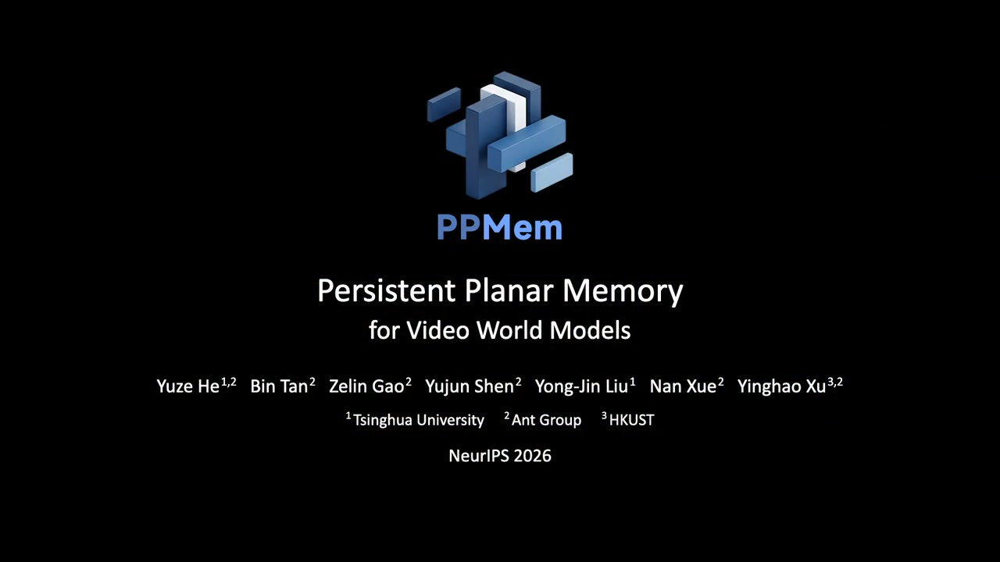
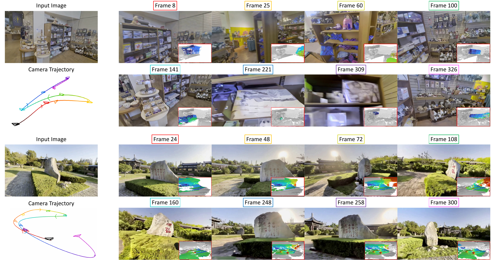

<p align="center">
  
</p>

<h1 align="center">Persistent Planar Memory<br>for Video World Models</h1>

<p align="center">
  <a href="https://hyzcluster.github.io/">Yuze He</a><sup>1,2</sup>,
  <a href="https://icetttb.github.io/">Bin Tan</a><sup>2</sup>,
  <a href="https://zelingao98.github.io/">Zelin Gao</a><sup>3,2</sup>,
  <a href="https://shenyujun.github.io/">Yujun Shen</a><sup>2</sup>,
  <a href="https://cg.cs.tsinghua.edu.cn/people/~Yongjin/Yongjin.htm">Yong-Jin Liu</a><sup>1,*</sup>,
  <a href="https://xuenan.net/">Nan Xue</a><sup>2,*</sup>,
  <a href="https://justimyhxu.github.io/">Yinghao Xu</a><sup>3,2</sup>
</p>

<p align="center">
  <sup>1</sup>Tsinghua University &nbsp;&nbsp;
  <sup>2</sup>Ant Group &nbsp;&nbsp;
  <sup>3</sup>HKUST
  <br><sup>*</sup>Corresponding authors.
  <br><strong>NeurIPS 2026</strong>
</p>

<p align="center">
  <a href="https://hyzcluster.github.io/ppmem/"></a>
  <a href="https://arxiv.org/abs/2610.23795"></a>
  <a href="https://huggingface.co/Robbyant-Research/PPMem"></a>
  <a href="#video"></a>
</p>

## Video

[](https://huggingface.co/Robbyant-Research/PPMem/resolve/main/assets/ppmem-demo.mp4)

## Overview

**PPMem generates camera-controlled video from a single image while building a persistent 3D memory of the scene.** Each video segment jointly predicts RGB and planar geometry. The planes are merged into a growing memory and rendered from upcoming camera viewpoints to guide subsequent generation.

- **Persistent planar memory.** Oriented planes represent surfaces with seven parameters per primitive.
- **Video and explicit geometry.** Generation produces RGB video together with depth, surface normals, and exportable plane geometry.
- **Camera-controlled exploration.** A supplied camera trajectory controls the generated views.

<p align="center">
  
</p>

## Getting started

[🛠️ Installation](#-installation) · [🤗 Model weights](#-model-weights) · [🚀 Run the included example](#-quick-start) · [🖼️ Use your own inputs](#-use-your-own-inputs) · [📦 Outputs](#-outputs) · [📖 Inference guide](docs/inference.md) · [📝 Citation](#-citation)

### 🛠️ Installation

Use Linux, Python 3.10 or later, Git, a C++ compiler, and a CUDA toolkit compatible with your PyTorch build and [FlashAttention-3](https://github.com/Dao-AILab/flash-attention/tree/de1584b5328321189a4d7832fe29bbd6813bf6ed/hopper). Make sure `nvcc` is available and `CUDA_HOME` points to the toolkit.

PPMem runs on a single NVIDIA GPU and uses about 19 GiB of GPU memory with the default settings. A GPU with at least 24 GB of memory is recommended.

FlashAttention-3 is optional. It is built for Ampere and Hopper GPUs only; on others, such as Blackwell GeForce and RTX PRO cards (sm_120), leave it out of the installation (remove its line from `requirements.txt`) and PPMem computes the same attention with PyTorch's `scaled_dot_product_attention`, at lower speed.

PyTorch 2.12 and later build CUDA extensions as C++20, which requires GCC 11 or later. If your system compiler is older (Ubuntu 20.04 ships GCC 9), install a newer one and point `CC` and `CXX` at it. In a conda environment, this command does both once you reactivate the environment:

```bash
conda install -c conda-forge gcc_linux-64=12 gxx_linux-64=12
```

First install a CUDA-enabled PyTorch and matching torchvision using the [PyTorch installation guide](https://pytorch.org/get-started/locally/). Choose the CUDA build for your environment. Clone the code repository, then run these commands in the same Python environment:

```bash
git clone https://github.com/robbyant-research/PPMem.git
cd PPMem

python -m pip install "packaging>=24.2" "setuptools>=78.1.1" wheel ninja versioningit einops
python -m pip install --no-build-isolation -r requirements.txt
python -m pip install --no-deps -e .
```

#### Check dependency imports

```bash
XFORMERS_DISABLED=1 python - <<'PY'
from flash_attn_interface import flash_attn_varlen_func
from diff_rect_rasterization import RectRasterizationSettings, RectRasterizer
from moge.model.v2 import MoGeModel
print("Dependency imports OK")
PY
```

#### Optional: MagiAttention on Hopper GPUs

PPMem uses FlashAttention-3 by default. On Hopper GPUs, you can install [MagiAttention v1.0.4](https://github.com/SandAI-org/MagiAttention/tree/v1.0.4) with CUDA toolkit 12.8 or later:

```bash
python -m pip install --no-build-isolation -e '.[magi]'
```

When installed, MagiAttention is used for the DiT's self-attention and cross-attention on these GPUs. Depth token fusion continues to use FlashAttention-3.

### 🤗 Model weights

PPMem automatically downloads [🤗 Robbyant-Research/PPMem](https://huggingface.co/Robbyant-Research/PPMem) on first use and reuses Hugging Face's local cache on subsequent runs.

For your own images, [MoGe 2](https://huggingface.co/Ruicheng/moge-2-vitl-normal) also downloads its weights automatically. The bundled example provides initial depth and intrinsics with `--init_geometry`, so it does not load MoGe.

To use weights you already have, add these options to your demo command:

| Model | Local override |
| --- | --- |
| PPMem | `--checkpoint /path/to/ppmem-checkpoint` |
| MoGe 2 | `--moge-checkpoint /path/to/moge-2-vitl-normal.pt` |

Both options also accept a Hugging Face repository ID. The PPMem directory must include its weight shards and index, plus `vae/`, `text_encoder/`, and `tokenizer/`. For offline use, provide local paths or populate the Hugging Face cache first and set `HF_HUB_OFFLINE=1`.

### 🚀 Quick start

[`examples/`](examples/) has three scenes, each with an input image, camera poses, frame-0 geometry and a text prompt. After installation, run the first **121 frames**:

```bash
scene=examples/scene01

bash scripts/run_demo.sh \
  --image "$scene/input.png" \
  --extrinsic "$scene/camera.npy" \
  --init_geometry "$scene/geometry.npz" \
  --prompt "$(cat "$scene/prompt.txt")" \
  --out runs/example \
  --max_steps 4 \
  --seed 42
```

The video is saved to **`runs/example/pool/generated_full.mp4`** at **1024 × 576**. The log is `runs/example/run.log`.

`--max_steps` is the **last chunk index**, not the number of chunks: `4` generates chunks 0–4, giving 121 frames. Omit it to run to the end of the supplied trajectory. Use a new or empty output directory; completed runs are skipped. See the [inference guide](docs/inference.md) for overwriting unfinished runs or resuming from a completed chunk.

### 🖼️ Use your own inputs

Provide an image, a scene prompt, and a camera trajectory. Without `--init_geometry`, PPMem estimates initial depth and intrinsics with MoGe.

| Input | Format |
| --- | --- |
| Image | Center-cropped to 16:9 and resized to 1024 × 576. |
| Camera poses | An `(N, 4, 4)` float32 `.npy` array of camera-to-world transforms, using OpenCV axes: +X right, +Y down, +Z forward. |
| Trajectory scale | Translation must use the same units as initial depth; MoGe provides estimated meters. |
| Initial geometry, optional | A `.npz` containing the first frame's depth and matching intrinsics. Store the depth at the image's own resolution, or crop it to the image's 16:9 center crop. |

The trajectory helper supports `dolly`, `pendulum`, and `spin`. Video chunks contain 25 frames and overlap by one frame; the last chunk takes whatever frames are left, so any frame count works. Use gradual camera motion relative to scene depth.

See the **[inference guide](docs/inference.md)** for a custom-image example, trajectory controls, the complete geometry format, runtime options, resume instructions, and the Python CLI.

## 📦 Outputs

```text
runs/example/
├── run.log                       # Demo script log
├── run_meta.json                 # Invocation parameters
├── chunks/chunk_000/             # Per-chunk output archives
└── pool/
    ├── generated_full.mp4        # Assembled video
    ├── diagnostic_grid.mp4       # RGB, depth, and projection diagnostics
    ├── merged_plane_params.pt    # Accumulated plane parameters
    └── merged_planes_world.ply   # Plane geometry in world coordinates
```

To inspect the plane pool, run:

```bash
python scripts/pool_report.py runs/example
```

The report is saved under `runs/example/pool_report/` and contains a growth chart, top-down views colored by source chunk and depth, and a JSON summary.

## 📝 Citation

```bibtex
@article{he2026ppmem,
  title   = {Persistent Planar Memory for Video World Models},
  author  = {He, Yuze and Tan, Bin and Gao, Zelin and Shen, Yujun
             and Liu, Yong-Jin and Xue, Nan and Xu, Yinghao},
  journal = {arXiv preprint arXiv:2610.23795},
  year    = {2026}
}
```

## Acknowledgments

PPMem builds on [Wan](https://github.com/Wan-Video/Wan2.2), [MoGe](https://github.com/microsoft/MoGe), [FlashAttention](https://github.com/Dao-AILab/flash-attention), [MagiAttention](https://github.com/SandAI-org/MagiAttention), and the [PlanarSplatting rectangle rasterizer](https://github.com/ant-research/diff-rect-rasterization).

## License

The code is licensed under the [Apache License 2.0](LICENSE). Model weights and third-party components retain their own licenses.
